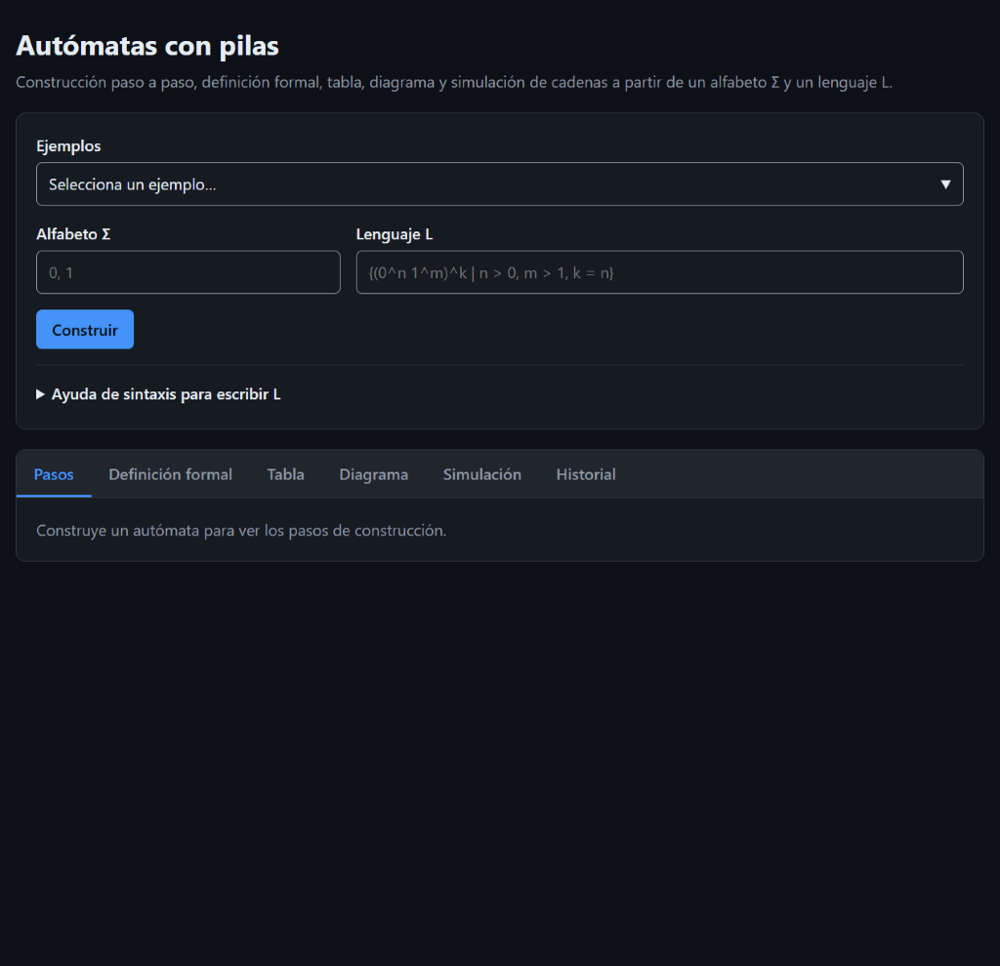
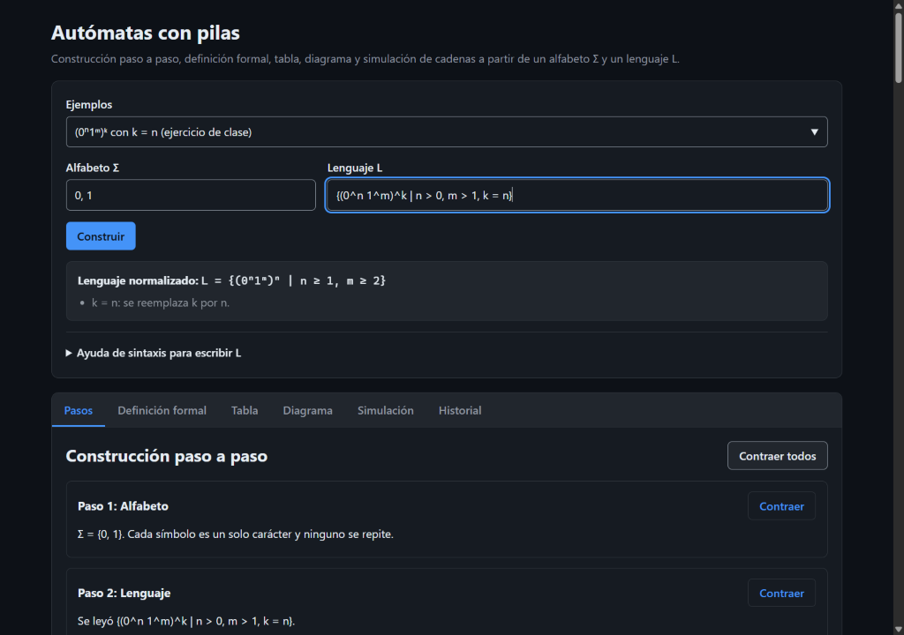
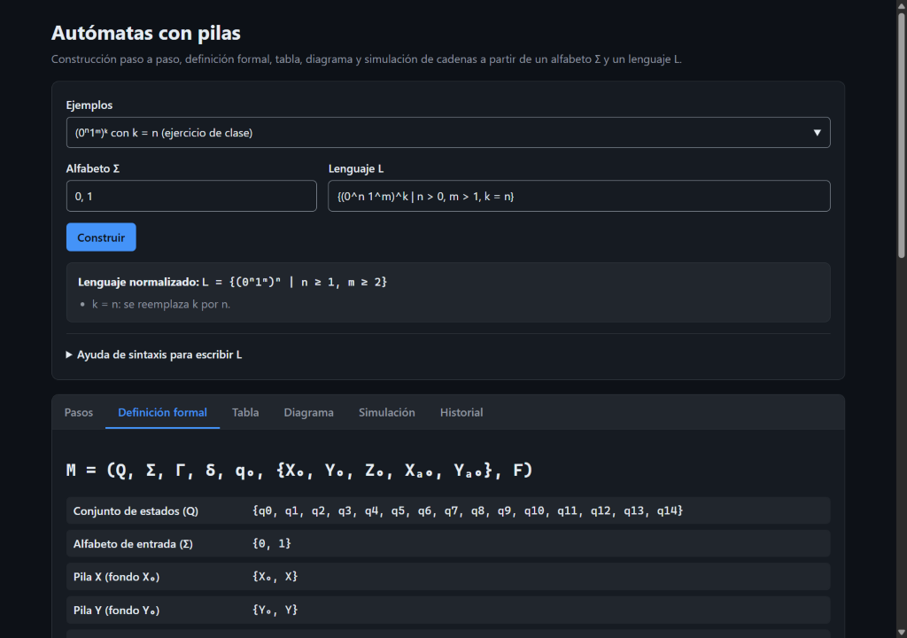
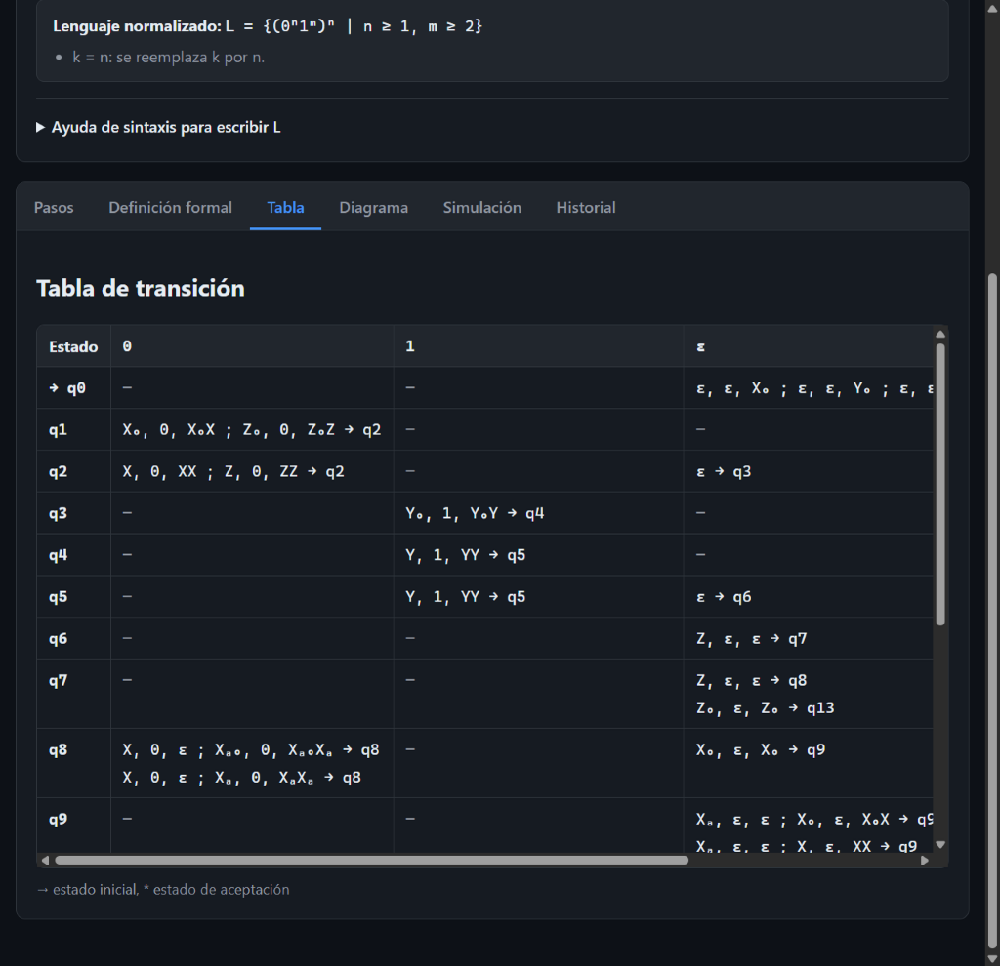
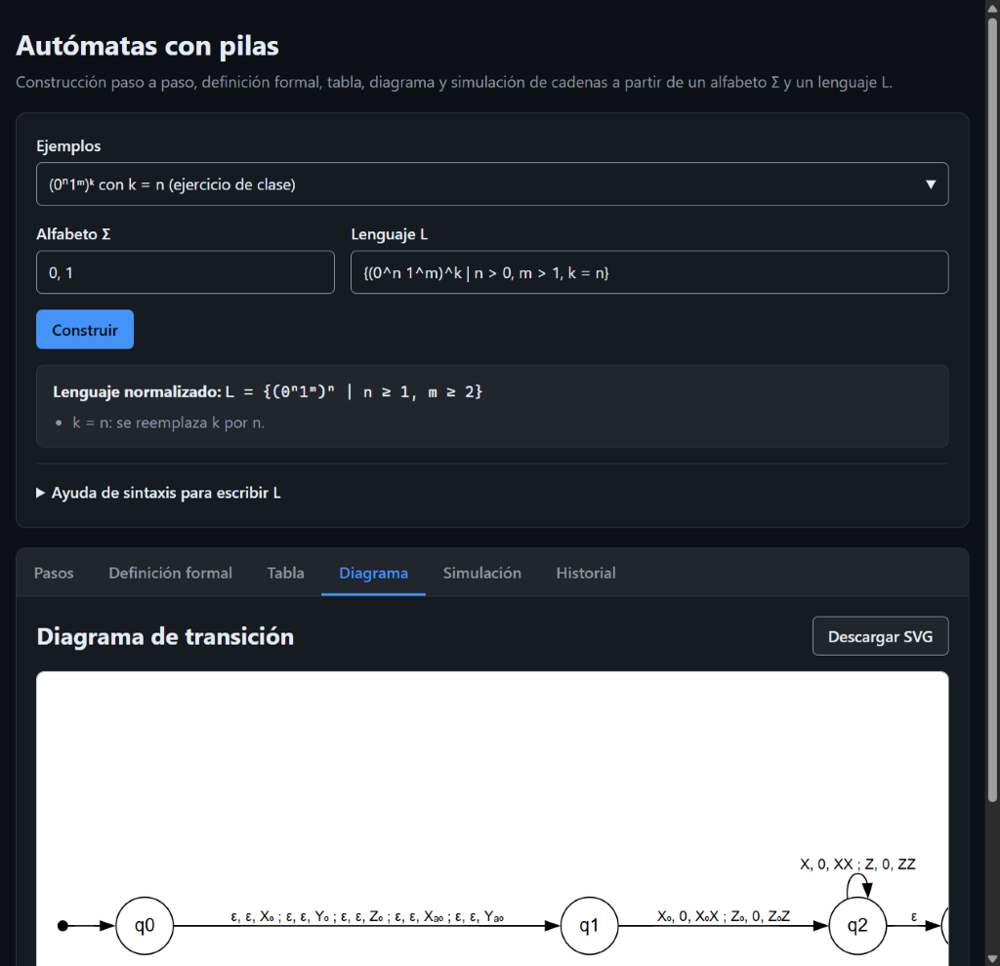
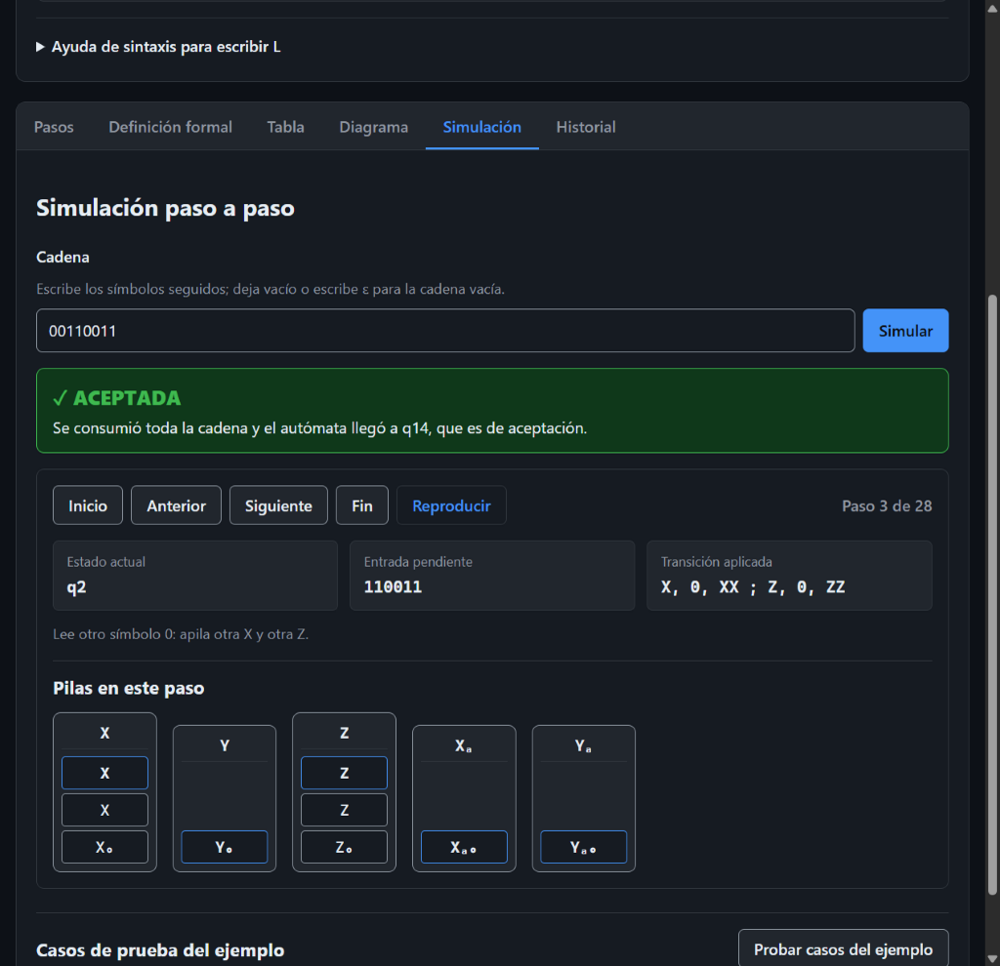
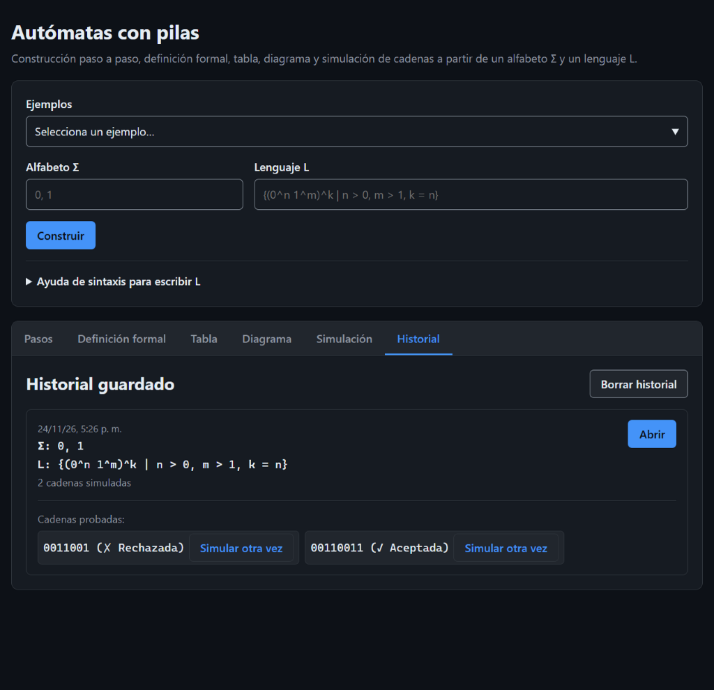

# Manual de usuario

Autores: David Santiago Rincón Bautista y Ángel Jhoan Díaz Vanegas.

**Autómatas con pilas** es una aplicación web educativa que, a partir de un alfabeto Σ y un lenguaje L escrito en notación de conjuntos, construye automáticamente un autómata a pila siguiendo el método por contadores de clase, explica cada paso de la construcción, genera su definición formal, tabla y diagrama de transición, y permite simular cadenas paso a paso viendo el estado de cada pila.

## 1. Requisitos e instalación

Se requiere **Node.js 22 o superior** (incluye `npm`). Desde la carpeta raíz del proyecto:

```bash
npm install
npm run dev
```

Luego abre en el navegador la dirección que muestra la terminal (normalmente `http://localhost:5173`).

Para probar la versión compilada de producción:

```bash
npm run build
npm run preview
```

## 2. Pantalla principal

La pantalla se divide en dos zonas: el panel superior para ingresar **Σ**, **L** o cargar un ejemplo, y el panel inferior con seis pestañas (`Pasos`, `Definición formal`, `Tabla`, `Diagrama`, `Simulación` e `Historial`).



## 3. Cómo escribir Σ y L

- **Alfabeto Σ:** escribe los símbolos de un solo carácter separados por comas o espacios, o en notación de conjunto. Son válidos `0, 1`, `a b`, `{a, b}` o `Σ = {a, b}`. Se admiten entre 1 y 10 símbolos, sin repetir caracteres ni usar símbolos reservados de la notación (`( ) { } ^ | : , ; = < > ! + * ε λ`).
- **Lenguaje L:** utiliza la forma `L = { patrón | condiciones }`. Tanto `L =` como las llaves son opcionales, y en lugar de `|` también puedes usar `:`.

| Se escribe                           | Significa                          |
| ------------------------------------ | ---------------------------------- |
| `a^n b^n \| n >= 0`                  | aⁿbⁿ con n ≥ 0                     |
| `a^n b^(2n)` o `a^n b^2n`            | aⁿb²ⁿ                              |
| `a^n b^m c^(n+m) \| n, m >= 1`       | aⁿbᵐcⁿ⁺ᵐ con n, m ≥ 1              |
| `(0^n 1^m)^k \| n > 0, m > 1, k = n` | (0ⁿ1ᵐ)ᵏ con k = n                  |
| `(0ⁿ1ᵐ)ᵏ : n>0, m>1, k=n`            | lo mismo, escrito con superíndices |

Se admiten mínimos (`n > 0`, `n >= 1`, `n ≥ 1`), valores fijos (`n = 3`) e igualdades entre variables (`k = n`, `m = 2n`). Si una variable no tiene condición explícita, se asume `≥ 0`.

Además, el selector **Ejemplos** incluye ocho lenguajes precargados listos para probar (`aⁿbⁿ`, `(0ⁿ1ᵐ)ᵏ con k = n`, `aⁿbᵐcⁿ`, `aⁿbᵐcᵐdⁿ`, `aⁿb²ⁿ`, `aⁿbⁿcⁿ`, `aⁿbᵐcⁿ⁺ᵐ` y `(ab)ⁿcⁿ`). Si modificas Σ o L después de construir un autómata, un aviso te recordará presionar **Construir** nuevamente para actualizar los resultados.

## 4. Qué muestra cada pestaña

- **Pasos:** lista numerada con toda la construcción paso a paso, incluyendo explicaciones, pilas creadas, estados y transiciones con botones para expandir o contraer cada bloque.
- **Definición formal:** la séptupla `M = (Q, Σ, Γ, δ, q₀, {fondos}, F)`, el alfabeto de cada pila, el listado completo de `δ` y el criterio de aceptación.
- **Tabla:** tabla de transición con una fila por estado y una columna por cada símbolo de `Σ` más `ε`. Marca `→` en el estado inicial y `*` en los estados de aceptación.
- **Diagrama:** representación gráfica en vector (SVG) generada con Graphviz, con flecha de entrada al estado inicial, doble círculo en el estado de aceptación, aristas paralelas agrupadas en la misma etiqueta y botón para descargar el archivo `.svg`.
- **Simulación:** evaluador de cadenas con recorrido paso a paso (`Inicio`, `Anterior`, `Siguiente`, `Fin` y `Reproducir`), entrada pendiente, transición aplicada, visualización vertical de cada pila y botón **Probar casos del ejemplo** cuando se usa un ejemplo precargado.
- **Historial:** registro persistente en el navegador (`localStorage`, hasta 20 entradas) que conserva construcciones y cadenas probadas para reabrirlas o volver a simularlas sin escribir los datos de nuevo.

## 5. Ejemplo completo de principio a fin (ejercicio del tablero)

Vamos a resolver el ejercicio de clase paso a paso:

1. En **Ejemplos**, selecciona `(0ⁿ1ᵐ)ᵏ con k = n (ejercicio de clase)` (o escribe `0, 1` en **Alfabeto Σ** y `{(0^n 1^m)^k | n > 0, m > 1, k = n}` en **Lenguaje L**).
2. Haz clic en **Construir**. Debajo del botón aparecerá el lenguaje normalizado `L = {(0ⁿ1ᵐ)ⁿ | n ≥ 1, m ≥ 2}` con la nota `k = n: se reemplaza k por n.`

### Pasos de construcción

En la pestaña **Pasos** se detallan los 18 pasos del proceso: validación de `Σ` y `L`, análisis de variables (`n`, `m`), creación de las cinco pilas (`X`, `Y`, `Z`, `Xₐ`, `Yₐ`) y cada pieza del autómata desde `q0` hasta `q14`.



### Definición formal

En **Definición formal** se muestra `M = (Q, Σ, Γ, δ, q₀, {X₀, Y₀, Z₀, Xₐ₀, Yₐ₀}, F)` junto con los conjuntos `Q = {q0, ..., q14}`, `Σ = {0, 1}`, los alfabetos por pila y las 27 transiciones de `δ`.



### Tabla de transición

En **Tabla** se listan las transiciones por estado y entrada (`0`, `1`, `ε`), mostrando `→ q0` como estado inicial y `* q14` como estado de aceptación.



### Diagrama de transición

En **Diagrama** Graphviz dibuja los 15 estados con sus aristas etiquetadas en notación `tope, entrada, reemplazo` (separando pilas con `;`). Si el grafo es ancho, puedes desplazarte horizontalmente o descargarlo con **Descargar SVG**.



### Simulación paso a paso (`00110011` aceptada y `0011001` rechazada)

1. Abre la pestaña **Simulación**, escribe `00110011` en **Cadena** y presiona **Simular**.
2. La aplicación muestra el resultado **✓ ACEPTADA** porque consume toda la cadena y alcanza `q14`.
3. Al presionar **Siguiente** tres veces hasta el **Paso 3 de 28**, se observa cómo el autómata está en `q2`, con entrada pendiente `110011`, tras aplicar `X, 0, XX ; Z, 0, ZZ`, apilando dos marcas en `X` y dos en `Z`.



4. Luego prueba `0011001` (al segundo bloque le falta un `1`): el simulador informa **✗ RECHAZADA** (_«Se consumió toda la cadena, pero ningún camino llega a un estado de aceptación.»_). También puedes pulsar **Probar casos del ejemplo** para verificar automáticamente las 10 cadenas esperadas del ejercicio.

### Historial

Al ir a la pestaña **Historial**, incluso después de recargar la página, queda guardada la construcción junto con las cadenas probadas (`00110011` y `0011001`), permitiendo reabrirla con **Abrir** o repetir cualquiera de sus simulaciones con **Simular otra vez**.



## 6. Errores comunes y cómo corregirlos

| Mensaje o problema                          | Causa                                                                 | Cómo corregirlo                                                                                |
| ------------------------------------------- | --------------------------------------------------------------------- | ---------------------------------------------------------------------------------------------- |
| _El símbolo «c» no pertenece al alfabeto Σ_ | Usaste en el patrón de `L` un símbolo terminal que no declaraste en Σ | Agrega ese símbolo en **Alfabeto Σ** (ej. `a, b, c`) o corrige la letra en **L**.              |
| _El símbolo «a» está repetido_              | Escribiste dos veces el mismo carácter en **Alfabeto Σ**              | Deja cada símbolo una sola vez separado por comas (`a, b`).                                    |
| _Falta cerrar un paréntesis / llave_        | Abriste `(` o `{` sin su correspondiente `)` o `}`                    | Revisa los pares de paréntesis y llaves siguiendo la posición indicada en el aviso.            |
| _Condición o construcción no soportada_     | Ingresaste desigualdades (`n < m`), grupos anidados o gramáticas      | Usa exponentes con variables iguales o múltiplos (`a^n b^(2n)`), mínimos e igualdades simples. |
